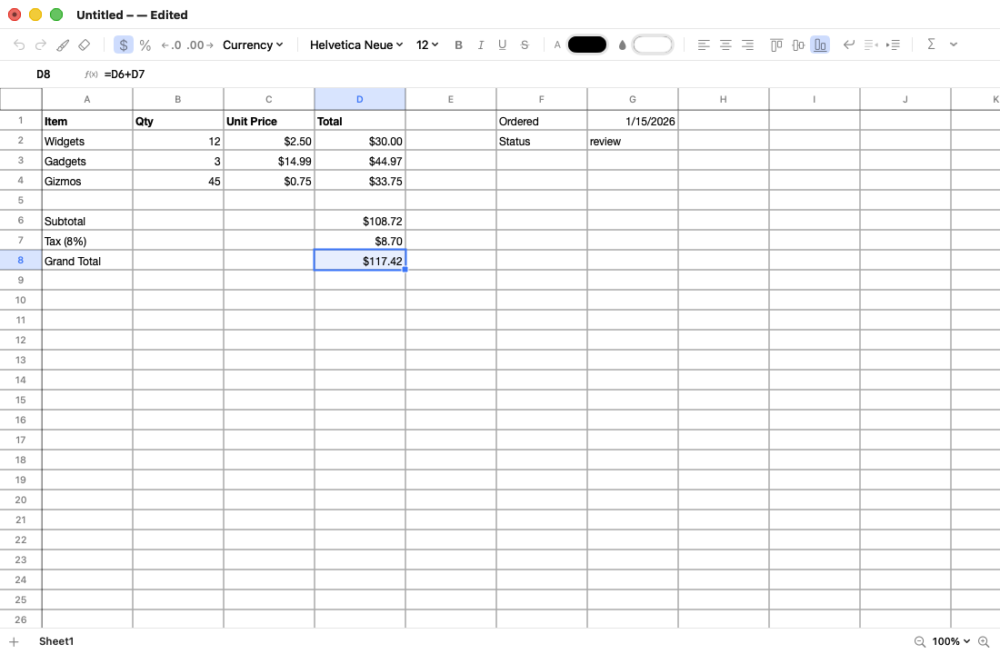

# SimpleSpread

A native spreadsheet app for the Mac and iPad, written entirely in Swift. Native file format
is XLSX; CSV imports and exports. The formula engine covers Google Sheets'
core feature set — 157 functions, real coercion semantics, incremental
recalculation. The spreadsheet stack (model, formula engine, XLSX/ZIP/CSV I/O,
grid) is built from scratch with no third-party libraries; the sole external
dependency is [Sparkle](https://sparkle-project.org) for software updates
on the Mac (not in the App Store builds).




**On iPad** the same app opens files from iCloud Drive and other places in
the Files browser, edits them in place, and saves as you go. It works by
touch, with a trackpad or mouse, and with a hardware keyboard. See
[docs/IPAD.md](docs/IPAD.md).

## Features

- **XLSX native**: reads and writes OOXML SpreadsheetML interoperable with
  Excel, Numbers, and Google Sheets — including a from-scratch ZIP layer,
  shared strings, styles, number formats, formulas with cached values,
  borders, merged ranges, frozen panes, whole-row and whole-column formats,
  hidden rows, columns and sheets, AutoFilters,
  defined names, newer functions saved with Excel's `_xlfn.` prefixes, and
  1904-date-system normalization on read. Charts, images, comments, tables,
  conditional formatting, data validation, hyperlinks, sparklines and print
  setup in a file are kept through a save, and they follow the cells when
  rows, columns or sheets change. When a file holds things SimpleSpread
  can't write back (chart sheets, macros, slicers…), the first save says so
  and offers to save a copy instead.
- **Pivot tables**: Insert ▸ PivotTable… and a PivotTable Fields panel
  like Excel's: drag fields into rows, columns, values and filters;
  summarize by sum/count/average/…; show values as % of total/row/column,
  difference, % of, running total; filter, sort, subtotals, blank lines,
  compact/outline/tabular layouts; group dates by years/quarters/months/days
  and numbers into ranges; Data ▸ Refresh (⌥F5). Pivots in files from Excel
  open, recompute, refresh and save intact, and GETPIVOTDATA reads them.
  Layouts are checked cell by cell against real Excel. See
  [docs/PIVOTS.md](docs/PIVOTS.md).
- **CSV done right**: delimiter sniffing, BOM/CP1252 encoding detection,
  quote-aware parsing, injection-safe import (a `=cmd` field is data, not a
  formula), leading-zero preservation, and RFC 4180 export with UTF-8 BOM,
  CRLF, full-precision numbers, and ISO dates.
- **Formula engine**: full operator set with Excel precedence (`-2^2 = 4`,
  `2^3^2 = 64`), Sheets-compatible type coercion and comparison ranking,
  SUMIF/COUNTIF criteria with wildcards, lazy IF, cross-sheet references,
  whole-row/column ranges, volatile functions, cycle detection, and
  iterative solvers for IRR/RATE/XIRR. See [docs/FUNCTIONS.md](docs/FUNCTIONS.md).
- **Spreadsheet-grade editing**: Excel's Ready/Enter/Edit state machine,
  type-to-replace, F2/double-click in-place editing, Cmd+arrow data-edge
  jumps, header selection and resizing with autofit, fill handle with
  formula translation, Fill Down / Fill Right (⌘D / ⌘R), Clear Formatting
  (⌘\), lossless internal clipboard plus TSV interop, and per-gesture undo —
  including undo of row/column/sheet operations.
- **Navigation**: Find (⌘F) with match navigation (⌘G / ⇧⌘G), a name box for
  jump-to-cell, and view zoom from 25%–400% (⌘+/⌘−/⌘0, status-bar control,
  and trackpad pinch).
- **File handling**: Open Recent (File menu) that actually reopens files under
  the sandbox via security-scoped bookmarks, Finder/`open` file association,
  and CSV/TSV/TXT import that forces Save-As to XLSX.
- **Software updates**: in-place auto-update via [Sparkle](https://sparkle-project.org),
  driven by GitHub Releases — a "Check for Updates…" menu item, automatic
  background checks, and one-click download-verify-replace-relaunch. See
  [docs/UPDATES.md](docs/UPDATES.md) for the signing-key and release setup.
- **Formatting**: font and size, bold/italic/underline/strikethrough,
  colors, borders (Excel's presets: bottom, outside, thick box, all, inside,
  double bottom and more, in every Excel line style), merged cells (Merge &
  Center, Merge Across, Unmerge), horizontal and vertical alignment, wrap
  text, indent, a format
  painter, increase/decrease decimal, one-click currency and percent, and the
  number-format menu (automatic, number, percent, currency, date, time,
  scientific, plain text) backed by a full Excel format-code renderer.
- **Sort and filter**: sort A→Z / Z→A by the selected column, or Custom
  Sort… with up to three levels; the table and its header row are found for
  you, whole rows move, and formulas follow their rows as in Excel. Data ▸
  Filter (⇧⌘L) puts filter buttons on the header row: pick values from a
  searchable checklist, or filter by condition (equals, contains, begins
  with, greater than, …). Filtered rows hide, their numbers turn blue, and
  the status bar leaves them out. Hide and unhide rows from the row header.
- **Frozen panes**: View ▸ Freeze Panes / Top Row / First Column keeps
  headers in place while the rest of the sheet scrolls.
- **Toolbar**: undo/redo, format painter, clear formatting, number, font,
  border, alignment and merge controls, Sort & Filter, and AutoSum (Σ: Sum,
  plus Average, Count, Max and Min from its menu), laid out in the order
  Excel's Home tab and the Google Sheets toolbar share.

## Performance

Time from launch until the window shows the spreadsheet (median of five
runs, on an M4 Pro Mac with 24 GB of memory and macOS 26.6), compared with
Apple Numbers 14.1 opening the same `.xlsx` files:

| Document | SimpleSpread | Numbers | |
|---|---:|---:|---|
| Empty workbook | 0.87 s | 2.12 s | 2.4× faster |
| Simple (a short invoice with formulas) | 0.88 s | 2.08 s | 2.4× faster |
| Complex (20,000 rows, 80,000 formulas, 7 sheets, 4 pivot tables) | 1.41 s | 5.43 s | 3.9× faster |

SimpleSpread 1.5.0 starts with a new, empty document in 0.43 s. The app is
8.6 MB (a 3.0 MB download); Numbers is 421 MB.

### Large files

Files open and save in the background with a progress bar and a Cancel
button, so the app never stops responding; you can keep editing while a
big file saves. A sheet holds 1,048,576 rows, as in Excel;
a bigger CSV opens its first 1,048,576 rows and says so. Time to read the
file and build its sheet (release build, same Mac), against version 1.4.1:

| File | Now | 1.4.1 | Peak memory |
|---|---:|---:|---:|
| 100 MB CSV (1.1 million rows) | 1.5 s | 29.8 s | 1.3 GB |
| 500 MB CSV (5.4 million rows) | 1.4 s | 6 min | 1.3 GB |
| 2 GB CSV (21 million rows) | 1.4 s | did not finish in 40 min | 1.3 GB |
| 66 MB XLSX: a full sheet, 1,048,576 rows × 10 columns, 1 million formulas | 2.5 s, plus 4.3 s calculating | 29.6 s | 2.8 GB |

Saving that full sheet takes 4.5 s (11.8 s in 1.4.1), at the same file size.
`swift run -c release spreadsheet-bench <file> [--save]` times each step.

## Building

Requires Xcode 16+ on macOS 14+ for the Mac app; Xcode 26 and
[XcodeGen](https://github.com/yonaskolb/XcodeGen) for the iPad app.

```bash
swift build            # debug build
swift test             # 900+ tests
swift run SimpleSpread # run the app directly
./scripts/build-app.sh # assemble SimpleSpread.app + DMG (ad-hoc signed)
./scripts/build-app-store.sh 1.9.0 1  # Mac App Store build (no Sparkle), signed .pkg
cd iOS && xcodegen && open SimpleSpread.xcodeproj  # the iPad app
```

## Documentation

- [docs/PLAN.md](docs/PLAN.md) — architecture, module map, design decisions,
  testing strategy, roadmap.
- [docs/RESEARCH.md](docs/RESEARCH.md) — the feature-set research (formula
  semantics, XLSX internals, editing UX, CSV) the implementation follows.
- [docs/FUNCTIONS.md](docs/FUNCTIONS.md) — all 157 functions with semantics
  notes and known deviations.
- [docs/PIVOTS.md](docs/PIVOTS.md) — using pivot tables: creating, the
  Fields panel, grouping, refreshing, and Excel features not supported.
- [docs/IPAD.md](docs/IPAD.md) — the iPad app: how the code is shared,
  building, testing, and the App Store.

## CI & releases

- **CI** (`.github/workflows/ci.yml`): every push/PR builds and runs the
  test suite on macOS 15, then boots the real app headlessly and captures a
  window render as an artifact.
- **Release** (`.github/workflows/build.yml`): manual dispatch with a
  version number → tests → arm64 release build → .app assembly → signing →
  DMG → optional notarization → GitHub Release. Signing/notarization use
  the repository secrets `APPLE_CERTIFICATE`, `APPLE_CERTIFICATE_PASSWORD`,
  `APPLE_SIGNING_IDENTITY`, `APPLE_ID`, `APPLE_PASSWORD`, and
  `APPLE_TEAM_ID`; without them the DMG is ad-hoc signed.
- **iPad** (`ci.yml`, job "iPad Build & Test"): on macOS 26 with Xcode 26,
  the shared tests and UI tests that drive the app on an iPad simulator.
  **iPad Release** (`.github/workflows/ipad-release.yml`): manual dispatch →
  archive → upload to App Store Connect / TestFlight. See
  [docs/IPAD.md](docs/IPAD.md).

## Debug hooks

```bash
SIMPLESPREAD_DEMO=1 swift run SimpleSpread            # seed demo content
SIMPLESPREAD_SCREENSHOT=/tmp/win.png swift run SimpleSpread  # render window to PNG and exit
SIMPLESPREAD_OPEN=/path/file.csv swift run SimpleSpread      # drive the real open→window flow
SIMPLESPREAD_ZOOM=1.5 SIMPLESPREAD_DEMO=1 swift run SimpleSpread  # launch at a zoom level
SIMPLESPREAD_FIND=term SIMPLESPREAD_DEMO=1 swift run SimpleSpread # open the find bar on a term
SIMPLESPREAD_SAMPLE_DIR=/tmp swift test --filter SampleFileGeneration  # emit sample .xlsx/.csv
```
