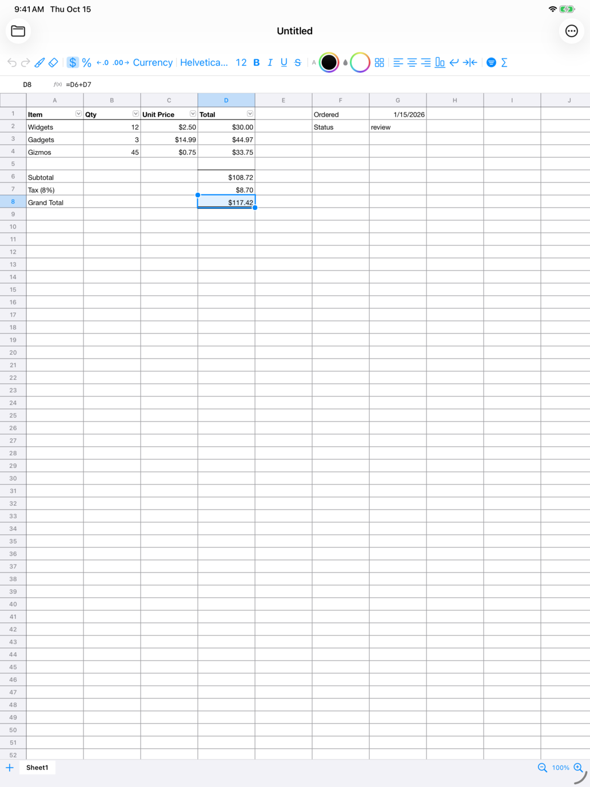

# SimpleSpread for iPad

The iPad app is the same app as the Mac one. Everything below the window
chrome is shared: the formula engine, the file formats, the document model,
the grid's drawing and its behaviour, and most of the SwiftUI chrome. Each
platform adds a thin shell for its own way of doing things.



## How the code is laid out

One Swift package builds both apps.

| Target / folder | Builds for | What it holds |
|---|---|---|
| `SpreadsheetCore`, `SpreadsheetFiles` | Mac, iPad | The engine and file formats. No platform code at all. |
| `SpreadsheetUI/Shared` | Mac, iPad | The document model, selection, undo, saving and loading in the background. It also holds the grid's geometry (`GridGeometry`), drawing (`GridRenderer`, plain Core Graphics) and behaviour (`GridController`: editing modes, selection, fill, resize, menus, keys), and the SwiftUI window content and menu commands. |
| `SpreadsheetUI/Mac` | Mac | The AppKit grid view (translates `NSEvent`s into `GridController` calls), save panels and prompts, Sparkle, and the app delegate. |
| `SpreadsheetUI/iOS` | iPad | The UIKit grid view (touch, pointer, pinch, hardware keys), the document browser, `SpreadsheetFile` (a `UIDocument`) and the editor screen. |
| `iOS/` (repo root) | iPad | The app target: an XcodeGen spec, the entry point, the icon, the privacy manifest and entitlements. |

**Platform code**

- Files in `Mac/` and `iOS/` are wrapped whole in `#if os(macOS)` or
  `#if os(iOS)`.
- Shared code never tests the platform. The few things AppKit and UIKit
  name differently (colours, fonts, checkbox and menu styles) go through
  `Shared/Platform.swift`.
- Sparkle is a Mac-only dependency.

**Where new work goes**

- A change to the engine, file formats, document, drawing, grid behaviour
  or panels lands on both platforms at once.
- A new way to *interact* (a gesture, a key) is the only part written twice:
  once in each grid view, as a call into `GridController`.

## Building and running

Requires Xcode 26 (the iOS 26 SDK) and [XcodeGen](https://github.com/yonaskolb/XcodeGen)
(`brew install xcodegen`).

```bash
cd iOS
xcodegen                       # writes SimpleSpread.xcodeproj (not checked in)
open SimpleSpread.xcodeproj    # scheme "SimpleSpread", any iPad simulator
```

**Signing:** set `SIMPLESPREAD_TEAM_ID=<team id>` before `xcodegen` so the
project signs with your team. Otherwise, pick the team in Xcode; it resets
the next time the project is generated.

**Debug hooks** (scheme environment variables, or `SIMCTL_CHILD_…` with
`xcrun simctl launch`):

- `SIMPLESPREAD_DEMO=1` opens the sample sheet.
- `SIMPLESPREAD_DEMO=layout` opens a sample with merges, frozen panes and a
  filter.
- `SIMPLESPREAD_OPEN=/path/file.csv` opens a file at launch.

These match the Mac hooks.

## Tests

```bash
swift test    # on the Mac: the whole suite
cd iOS && xcodebuild test -project SimpleSpread.xcodeproj -scheme SimpleSpread \
  -destination 'platform=iOS Simulator,name=iPad Pro 13-inch (M5)'
```

The iPad scheme runs:

- **The shared tests on the iPad simulator.** That's every test except those
  for Mac-only code: the AppKit grid, ⌘S save prompts, Open Recent.
- **UI tests that drive the app.** They create a document in the browser,
  type in cells, close it (which saves), reopen it, navigate and undo with a
  hardware keyboard, and open a CSV.
- **`ReviewTests`,** which screenshot the menus, the filter popover, editing
  with the on-screen keyboard and pinch zoom, for a person to look over.
  Export them with
  `xcrun xcresulttool export attachments --path <result bundle> --output-path <dir>`.

`RenderTimingTests` checks a dense 13-inch screenful draws well inside a
frame: about 8 ms in a debug build on Apple silicon, faster in release. The
iPad redraws the visible screen as it scrolls.

CI (`.github/workflows/ci.yml`, job "iPad Build & Test") runs all of this on
a `macos-26` runner.

## How the iPad app behaves

**Files**

- Each window opens on the system document browser: iCloud Drive, On My
  iPad, and other providers.
- A file opens full screen and is edited in place. There's no Save: the
  file saves itself as it changes, and when it's closed with the folder
  button.
- File ▸ Save (⌘S) saves now. Save a Copy, Import CSV as Sheet and Export
  Sheet as CSV are in the ⋯ menu and the File menu.

**Content SimpleSpread can't save** (chart sheets, macros, slicers): as on
the Mac, the file isn't written over silently. The first edit asks:

- Save a Copy…: the edits go to the copy, and the original is untouched.
- Save Changes Anyway.
- Not Now: nothing is saved until the user chooses. Closing asks again.

**CSV:** a CSV opens as a new `.xlsx` beside it (in On My iPad › SimpleSpread
if its folder is read-only). The text file is never written over.

**Touch**

- Tap selects a cell.
- Tapping the selected cell again shows Edit, Cut, Copy, Paste, Select All
  and Fill Down.
- Double-tap edits the cell.
- Drag the round grips to grow the selection.
- Drag a header edge to resize a column or row; double-tap the edge to fit
  the column to its contents.
- Long-press (or right-click) a header or cell for its menu.
- Pinch to zoom.

**Pointer:** works as on the Mac. Click-drag selects and the fill handle
works. The pointer becomes a resize beam over header edges.

**Keyboard**

- With a hardware keyboard: arrows, ⌘-arrows, Shift-extend, Return, Tab,
  Delete, Home, Page Up and Down, Escape and F2 work as on the Mac. Typing
  replaces the cell.
- The on-screen keyboard's shortcut bar adds `= ( ) : $ ,` and Tab.

**Menus:** the iPadOS menu bar shows the same Edit, View, Insert, Data and
Format menus as the Mac.

**Confirmations** (merging over values, a pivot over data): iPad alerts
don't block, so the command asks and then runs again if the user agrees
(`SpreadsheetDocument.confirmLater`).

**VoiceOver:** reads the selected cell and what it shows, on both platforms.

## Selling it: App Store Connect

### Universal Purchase

- The iPad app has the Mac app's bundle ID, `com.kikiplan.simplespread`, so
  both are **one App Store record and one purchase**.
- In App Store Connect, open the Mac app and use **Add Platform › iOS**.
- Consequences:
  - One price buys both.
  - Once both platforms are approved, a platform can't be removed.
  - The description and screenshots are per platform.
- **iPad only, or iPhone too:** Apple's wording ("to offer the app on
  iPhone and iPad, your app needs to support both devices") is ambiguous
  for an iPad-only app in a universal record. The target is iPad only
  (`TARGETED_DEVICE_FAMILY = 2`). If App Store Connect insists on iPhone,
  set it to `1,2`: the shared UI already runs there, but the toolbar wants
  a compact layout first.

### The Mac App Store build

`scripts/build-app-store.sh <version> <build>` builds the Mac app for the
store:

- No Sparkle (the `SIMPLESPREAD_APP_STORE` package flag removes it and its
  menu items).
- A universal arm64 + x86_64 binary.
- The App Store Info.plist keys and `entitlements-appstore.plist` (sandbox,
  no network).

With `TEAM_ID`, `APP_SIGN_IDENTITY`, `PKG_SIGN_IDENTITY` and `PROFILE` set,
it signs and writes the `.pkg` to upload with Transporter. The GitHub
Releases build (`build.yml`, with Sparkle) is unchanged.

### Uploading the iPad app

Run the **iPad Release** workflow (`.github/workflows/ipad-release.yml`)
with the version. It archives and uploads to App Store Connect, where the
build appears in TestFlight. It needs an App Store Connect API key
(Users and Access › Integrations › Keys, role App Manager) in the
repository secrets:

- `APP_STORE_CONNECT_KEY_ID`
- `APP_STORE_CONNECT_ISSUER_ID`
- `APP_STORE_CONNECT_KEY` (the `.p8` file's contents)
- `APPLE_TEAM_ID` (already set)

Signing is automatic: the key lets Xcode create the distribution
certificate and profile.

You can also archive and upload from Xcode: Product ▸ Archive, then
Distribute App.

### Checklist for the first submission

- **Agreements:** Paid Apps agreement, tax and banking, EU trader status
  (DSA) and the age rating are per account or per record, so they're
  shared with the Mac app. Enrol in the Small Business Program (15%).
- **App Privacy:** "Data Not Collected". The app has no analytics, no
  accounts and no network use. The privacy manifest
  (`iOS/SimpleSpread/PrivacyInfo.xcprivacy`) declares the same, plus its
  required-reason APIs: its own preferences (CA92.1) and the dates of files
  the user opens (3B52.1, C617.1).
- **Privacy policy URL** and **support URL:** required. The README or a
  GitHub page is enough.
- **Export compliance:** `ITSAppUsesNonExemptEncryption = NO` is in the
  Info.plist, so there's no question at upload.
- **Age rating:** 4+.
- **iPad screenshots (13-inch, required):**
  - 2064 × 2752 portrait or 2752 × 2064 landscape, no transparency.
  - The iPad Pro 13-inch simulator's screenshots are exactly that size.
  - `SimpleSpreadUITests/testScreenshots` takes them; run them in light
    mode with the status bar set
    (`xcrun simctl status_bar booted override --time 9:41`).
- **Icon:** `iOS/SimpleSpread/Assets.xcassets/AppIcon.appiconset/AppIcon.png`,
  1024 × 1024 and opaque.
  - It's made by `swift scripts/generate-icon.swift --full-bleed <path>`,
    from the same art as the Mac icon.
  - For iOS 26's dark, tinted and clear icon looks, an Icon Composer
    `.icon` file can replace it later.
- **Description:** say what it doesn't do, so reviews don't have to:
  charts are kept in files but not shown or edited, and there's no
  co-editing.

## Not done yet

- **iCloud Drive folder:** an iCloud container would give SimpleSpread its
  own folder in iCloud Drive. Files already open and save anywhere through
  the browser.
- **iPhone layout:** see Universal Purchase above.
- **Stage Manager:** narrow windows work (the toolbar scrolls), but the
  toolbar isn't rearranged for them.
- **Very large files:** the increased memory limit entitlement is
  requested.
  - The Mac's largest test files (2.8 GB peak for a million formulas) will
    still be too much for a 4 GB iPad.
  - There are no size guards yet.
